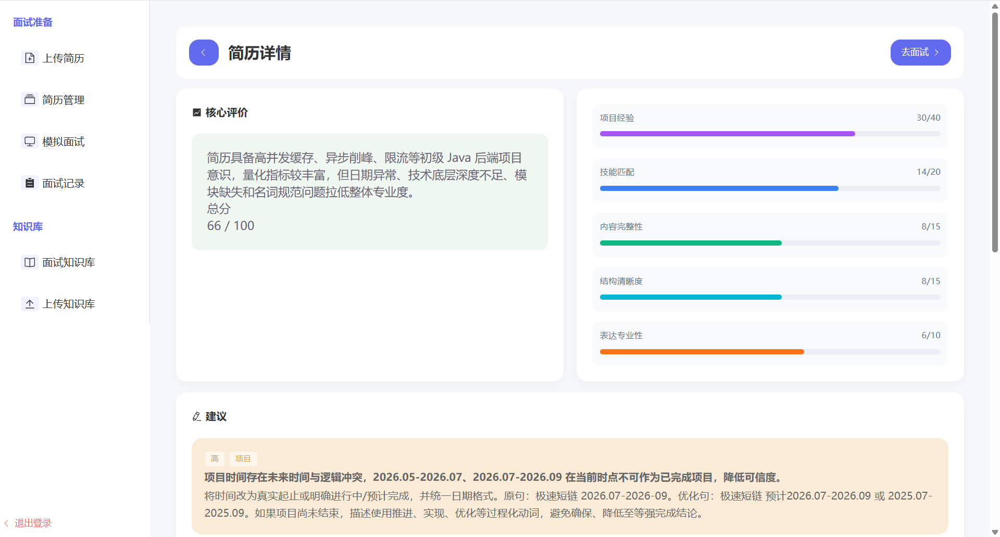
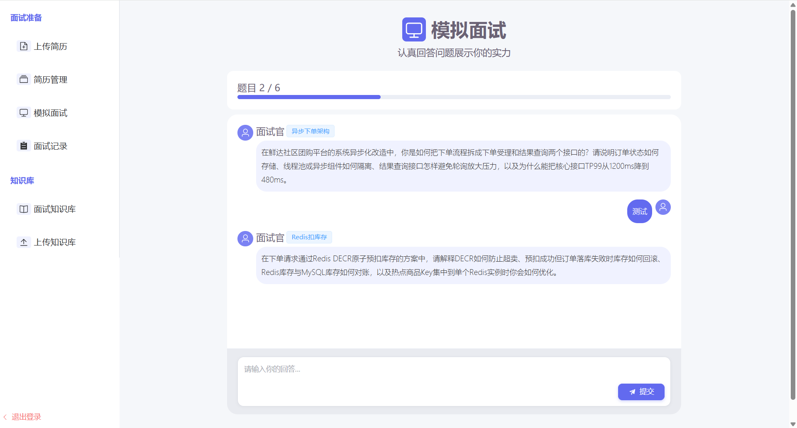
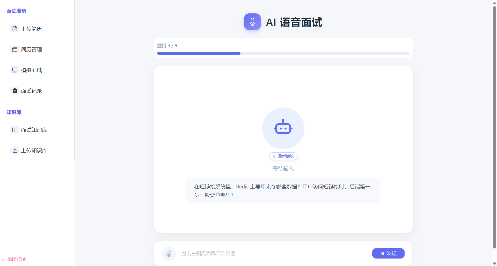
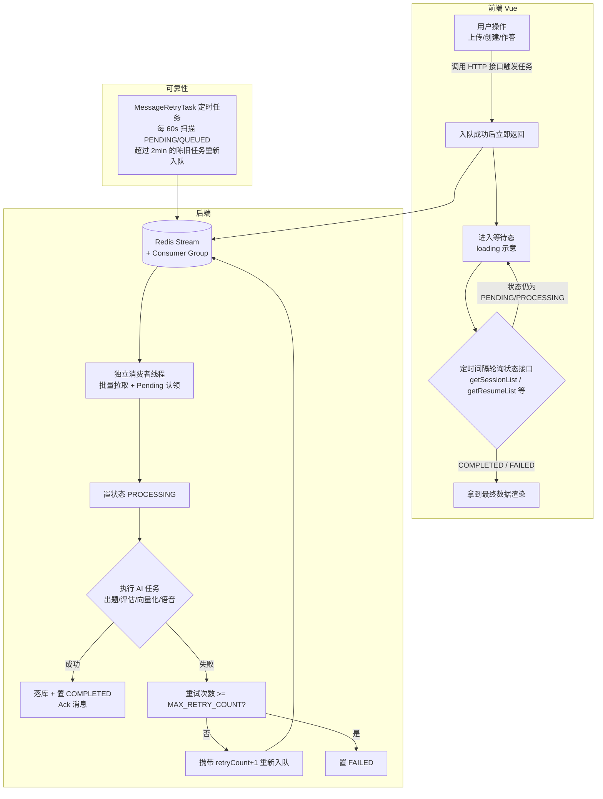
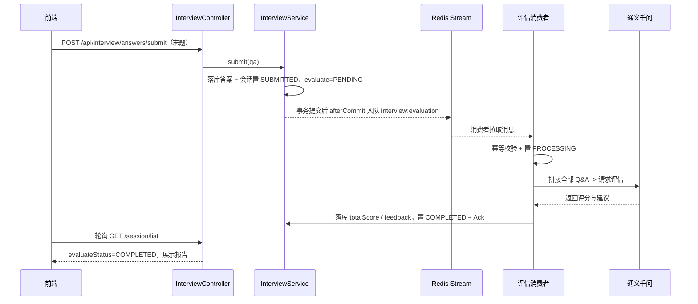
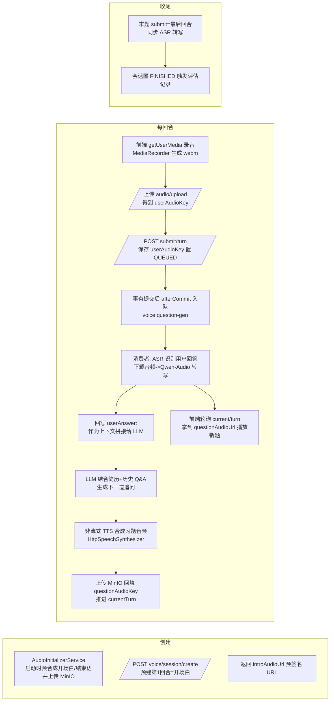

# AI 模拟面试系统

一个**前后端分离**的 AI 模拟面试平台：上传简历后被 AI 深度追问、提供简历/知识库两类文字面试，以及带语音识别与语音合成的**口语面试**，最终生成多维度评估报告。所有耗时任务（AI 出题、评估、向量化、语音合成）都通过 **Redis Streams 异步状态机**解耦执行，接口即时响应，体验流畅。

> 数据层使用 PostgreSQL + pgvector，向量库为 Spring AI 的 `VectorStore`；LLM / ASR（语音识别）/ TTS（语音合成）均接入阿里云通义千问（DashScope）。

---

## 一、技术栈

### 后端 Backend
| 分类 | 技术 |
| --- | --- |
| 语言 / 框架 | Java、Spring Boot 3.x、Spring AI |
| 数据库 | PostgreSQL 16（+ pgvector 向量扩展） |
| ORM | MyBatis-Plus 3.5.7 |
| 消息 / 异步 | Redis Streams + Consumer Group（通过 Redisson 3.48 封装） |
| 缓存 / 限流 | Redis、Spring Data Redis、Redisson |
| 大模型 / 多模态 | DashScope 通义千问（LLM 出题 / 评估、Qwen-Audio ASR、HttpSpeechSynthesizer TTS） |
| 对象存储 | S3 兼容存储（MinIO），预签名 URL 直传直读 |
| 安全 | Spring Security + BCrypt + JWT，AOP 限流 |
| 工具 | Lombok、Hutool、Jackson、PDFBox（文档解析） |

### 前端 Frontend
| 分类 | 技术 |
| --- | --- |
| 框架 | Vue 3.5（组合式 API）、TypeScript |
| UI | Element Plus + @element-plus/icons-vue |
| 路由 / 请求 | Vue Router、Axios |
| 构建 | Vite（`rolldown`）+ TypeScript |
| 录音 | Web API `MediaRecorder` / `getUserMedia` |

---

## 二、核心功能

| 模块 | 说明 |
| --- | --- |
| 用户中心 | 注册 / 登录（JWT），密码 BCrypt 加密，接口按 IP / 全局维度限流 |
| 简历管理 | 上传解析（PDF / Word / Markdown / TXT），去重、AI 深度分析给出评分与建议 |
| 简历面试 | 后端异步调用大模型基于简历项目经历定制出题，逐题作答，最终汇总评估 |
| 知识库面试（RAG） | 上传文档 -> 切块 -> 语义向量化（pgvector）-> 基于检索结果动态出题 |
| 语音面试 | 口语对话型：录音 -> ASR 识别 -> LLM 实时追问 -> TTS 语音播报题目 |
| AI 评估报告 | 多维度评分（项目 / 技能匹配 / 表达等）+ 逐题追溯 + 改进建议 |
| 会话 / 记录 | 文字、语音面试历史记录，删除会话 |

---

## 页面截图

### 简历详情


### 文字面试


### 语音面试


---

## 三、异步状态机详解

系统把**所有耗时的 AI 任务**都放到 Redis Stream 异步消息里执行，HTTP 请求只负责"落库 + 入队 + 立即返回"。这也是本项目最核心的架构亮点之一。

### 3.1 异步任务一览

| Stream Key | 用途 | 触发点 |
| --- | --- | --- |
| `resume:analysis:stream` | 简历 AI 分析 | 简历上传后 |
| `interview:question-gen:stream` | 简历面试出题 | 创建简历面试后 |
| `knowledgebase:vectorize:stream` | 文档切块 + 向量化入库 | 知识库文件上传后 |
| `knowledgebase:question-gen:stream` | 知识库 RAG 出题 | 手动触发出题后 |
| `interview:evaluation:stream` | 面试整体评估 | 末题提交后 |
| `voice:question-gen:stream` | 语音下回合出题（ASR+出题+TTS） | 语音每回合作答后 |

### 3.2 整体流转（生产者 / 消费者 / 状态机 / 前端轮询）



### 3.3 关键设计点

**为何用"事务提交后再入队"（`afterCommit`）？**
出题 / 评估 / 语音出题的消费者会立刻去读库里刚刚写入的状态和答案。如果在事务提交 **之前** 就入队，消费者可能读到旧数据（比如答案还没写进去），导致"重复处理 / 幂等跳过"等竞态问题。因此代码统一在 `TransactionSynchronization.afterCommit()` 里投递消息，**保证消费端拿到的永远是提交后的最新数据**。

**状态如何落地与去重？**
- 任务状态（PENDING / PROCESSING / COMPLETED / FAILED / QUEUED）直接保存在业务表的状态列里（如 `session_questiongen_status`、`question_gen_status`）。
- 消费者在处理前先做**幂等校验**（比如题目/评估已是 COMPLETED 则直接 Ack 跳过），并用 PostgreSQL 行级锁 `FOR UPDATE` 保证并发下只有一个消费者能推进状态。
- 消息本身通过 **Stream 的消息 ID + Ack** 确认，配合 `registerConsumer` 启动的单线程消费者，天然按序可靠消费。

**失败重试与兜底？**
- 单条消息失败：携带 `retryCount` 重新入队，最多重试 3 次（`MAX_RETRY_COUNT`），超过则置 `FAILED` 并落库，供前端体现失败态。
- 兜底恢复：`MessageRetryTask` 定时任务每 60s 扫描所有 `PENDING / QUEUED` 且超过 2 分钟未更新的任务，重新入队——**即使消费者中途挂掉、消息在内存里耗尽，也能从数据库状态恢复任务**。
- Stream 自动裁剪（`STREAM_MAX_LEN = 1000`），防止历史消息无限堆积。

### 3.4 面试评估状态机示例（文字面试）



**前端数据来源速查**
| 想查什么 | 查哪个接口 | 拿哪个状态字段 |
| --- | --- | --- |
| 简历是否分析完成 | `GET /api/resume/list` | `asyncTaskStatus` |
| 简历面试题目是否生成 | `GET /api/interview/session/detail` | `sessionQuestionGenStatus` |
| 知识库是否向量化完成 | `GET /api/kbs/list` | `vectorStatus` |
| 知识库是否出题完成 | `GET /api/kbs/question` / `GET /api/kbs/list` | `questionGenStatus` |
| 文字面试是否评估完成 | `GET /api/interview/session/list` | `sessionEvaluateStatus` |
| 语音面试出题是否完成 | `GET /api/interview/voice/current/turn` | `questionGenStatus` |

> 轮询落地：`resume.vue` / `record.vue` / `knowledgeBase.vue` 通过 `setTimeout` 递归轮询对应列表接口，直到状态为 `COMPLETED / FAILED` 才停止。

---

## 四、语音面试技术流程

语音面试是一个"录音 -> 识别 -> 追问 -> 语音播报"的**全双工对话闭环**，核心依赖通义千问的 **Qwen-Audio（ASR）** 与 **HttpSpeechSynthesizer（TTS）**。



**流程要点：**
1. **开场白预合成**：`AudioInitializerService` 在应用启动时就把固定的开场白 / 结束语合成好并存入对象存储，避免首次进入时等待 TTS。
2. **录音与上传**：浏览器 `navigator.mediaDevices.getUserMedia` 采集麦克风，`MediaRecorder` 产出 WebM 音频，通过 `audio/upload` 上传并返回存储 Key；所有音频按 `ai-interview/voiceInterview/{userId}/{sessionId}/` 结构化存储，便于按会话清理。
3. **回合推进（异步）**：作答后立即 `submit/turn` 只落库音频 Key 并置 `QUEUED`，随后**事务提交后入队** `voice:question-gen`。消费者依次完成 **ASR 转写 -> LLM 出下一题 -> TTS 合成 -> 落库 -> 推进 `currentTurn`**。
4. **末题收尾**：最后回合不在 Stream 里异步出题，而是**同步 ASR 转写**后将会话置 `FINISHED`，评估结果走通用面试评估流程。
5. **防抖与幂等**：`questionGenStatus`（QUEUED / PROCESSING / COMPLETED / FAILED）控制前端"上一题出题中"的等待态；消费者对"下一回合已存在"做幂等跳过，避免重复合成。

**ASR / TTS 实现细节**
- ASR：走 DashScope 多模态原生 HTTP 接口，把音频 `base64` 直接内嵌在请求体 `input_audio` 中，显式关闭 SSE（`X-DashScope-SSE: disable`）一次拿到完整识别文本，wav 采样率交给模型从文件头读取避免冲突。
- TTS：用官方 SDK `HttpSpeechSynthesizer.callAndReturnAudio` **非流式**阻塞合成，一次性返回完整音频字节再上传对象存储；音色 / 模型 / 采样率均从 `application.yaml` 的 `voice.interview.tts` 读取。

---

## 五、项目优点

- **异步解耦 + 即时响应**：所有 AI 耗时任务走 Redis Stream，HTTP 只负责"落库 + 入队"，接口秒回，配合前端轮询，用户体验稳定顺畅。
- **完整的状态机与可靠性**：`状态落库 + FOR UPDATE 行锁 + 消息 Ack + 重试入队 + 定时兜底恢复` 多维保障，消费端即使宕机也能从数据库状态自愈，同时用幂等校验杜绝重复处理。
- **杜绝竞态的"事务后入队"**：统一在 `afterCommit` 投递消息，保证消费端永远读到提交后的最新数据，是保证正确性的关键细节。
- **RAG 知识库**：基于 pgvector 的语义检索，让面试题目真正"从用户自己的技术资料里长出来"，而非固定题库。
- **语音全闭环**：录音 -> ASR -> LLM 追问 -> TTS -> 播放一站式打通，开场白预热 + 音频 Key 结构化存储 + 幂等合成，细节到位。
- **工程化与安全**：JWT + BCrypt、AOP 多维度限流（IP / 全局 + 滑动窗口脚本）、对象存储预签名 URL 直传直读（带宽不经过后端）、全局统一异常处理。
- **前后端分离、类型清晰**：前后端各自独立目录与构建（Vite + TypeScript），前后端共用状态枚举（`AsyncTaskStatus` / `QuestionGenStatus`）语义一致，便于协作与维护。

---

## 六、目录结构

```
ai-interview/
├── backend/                          # Spring Boot 后端
│   ├── pom.xml
│   └── src/main/
│       ├── java/com/yun/aiinterview/
│       │   ├── controller/           # 面试 / 知识库 / 简历 / 用户 / 语音 控制器
│       │   ├── service/              # 业务服务 + 异步状态机 / ASR / TTS
│       │   └── scheduler/            # MessageRetryTask 兜底重试
│       └── resources/
│           ├── application.yaml
│           ├── db/                   # 数据库建表脚本
│           ├── mapper/               # SQL / ORM 映射
│           └── prompts/              # AI 提示词模板
└── frontend/                         # Vue 3 前端
    ├── package.json
    └── src/
        ├── api/                      # Axios 接口封装
        ├── views/                    # 登录 / 简历 / 面试 / 知识库 / 语音面试等页面
        └── router/
```

---

## 七、部署指南

本项目通过 `docker-compose` 一键编排 PostgreSQL / Redis / MinIO / 后端 / 前端（nginx）。**打包在本地完成，服务器上只负责传输文件 + 启动容器**，无需在服务器上安装 JDK / Maven / Node（JDK 需要单独解压到挂载目录供容器使用）。

### 7.1 需要自行上传到服务器的文件

| # | 文件 | 来源 | 服务器存放位置 | 说明 |
| --- | --- | --- | --- | --- |
| 1 | `docker-compose.yml` | 项目根目录 | `/root/project/ai-interview/docker-compose.yml` | 服务编排文件 |
| 2 | `Dockerfile` | 后端 [backend/Dockerfile](backend/Dockerfile) | 项目根目录（与 docker-compose.yml 同级） | 后端镜像基于 ubuntu:22.04，`JAVA_HOME=/opt/java`，需与 `app.jar` 放同一目录 |
| 3 | `app.jar` | 后端打包产物（见 7.2） | 项目根目录 `/root/project/ai-interview/app.jar` | **必须命名为 `app.jar`**，数据卷挂载到容器 `/app/app.jar` |
| 4 | `html/`（前端静态页面） | 前端构建产物 `frontend/dist/*`（见 7.2） | `/root/project/ai-interview/nginx/html/` | 挂载为 nginx 的 `/usr/share/nginx/html` |
| 5 | `default.conf` | 仓库 [nginx/defualt.conf](nginx/defualt.conf)，**需重命名为 `default.conf`** | `/root/project/ai-interview/nginx/default.conf` | nginx 配置：静态托管 + `/api/` 反向代理到后端 |
| 6 | `.env` | 项目根目录 `.env` | 项目根目录 `/root/project/ai-interview/.env` | 填好自己的 `ALIYUN_APIKEY`，MinIO 密钥默认即可（见 7.4） |
| 7 | JDK21 Linux 版安装包 | 自行下载（如 `jdk-21_linux-x64_bin.tar.gz`） | 解压到服务器 `/opt/java`，保证存在 `/opt/java/bin/java` | 挂载为容器 `/opt/java`（只读），`Dockerfile` 直接用宿主机 JDK |
| 8 | 初始化 SQL | 后端 [backend/src/main/resources/sql/init.sql](backend/src/main/resources/sql/init.sql) | `/root/project/ai-interview/postgresql/init/init.sql` | 首次启动空数据目录时自动建表（非空目录则不会执行） |

> 服务器上的 `postgresql/data`、`redis/data`、`minio/data` 数据卷目录**无需手动创建**，由 docker 自动生成。

### 7.2 打包本地产物

**后端打包（需要 JDK21 + Maven）：**

```bash
cd backend
mvn clean package -DskipTests
# 将 target/backend-0.0.1-SNAPSHOT.jar 重命名为 app.jar 后上传
```

**前端打包（需要 Node.js）：**

```bash
cd frontend
npm install
npm run build
# 将 dist/ 目录下的所有内容上传到服务器的 nginx/html/ 目录
```

> 前端 axios 使用相对路径请求 `/api/...`，由 nginx 反向代理到后端，**无需任何前端环境变量配置**；`/api/` 代理超时已调至 300s 以兼容大模型长耗时接口。

### 7.3 服务器最终目录结构

```
/root/project/ai-interview/
├── docker-compose.yml
├── Dockerfile                    # 从 backend/Dockerfile 复制
├── .env                          # 填好 ALIYUN_APIKEY
├── app.jar                       # 后端打包产物（必须命名为 app.jar）
├── nginx/
│   ├── default.conf              # 从 nginx/defualt.conf 复制并重命名
│   └── html/                     # 前端 npm run build 产物
├── postgresql/
│   ├── init/                     # 放置 init.sql
│   └── data/                     # 自动创建
├── redis/
│   └── data/                     # 自动创建
└── minio/
    └── data/                     # 自动创建
```

另外还需在服务器上解压 JDK21 到 `/opt/java`，并确认：
- `/opt/java` 下就是 JDK 根目录（`/opt/java/bin/java` 存在），与 `Dockerfile` 的 `JAVA_HOME=/opt/java` 严格对应；
- 应为 **Linux x64 版本**、必须是 **JDK 21**（不要用 Windows 版或 JRE）。

### 7.4 配置 `.env`

```bash
# 阿里云 DashScope API Key（必填，否则后端调模型会 401）
ALIYUN_APIKEY=sk-xxx
# MinIO 密钥（minio 和 backend 共用，保持一致即可）
MINIO_ROOT_USER=minioadmin
MINIO_ROOT_PASSWORD=minioadmin123
MINIO_ACCESSKEY=minioadmin
MINIO_SECRETKEY=minioadmin123
```

### 7.5 启动服务

```bash
cd /root/project/ai-interview
docker compose up -d --build     # 首次需要构建后端镜像，后续只需 up -d 即可
docker compose ps                # 查看容器状态（全部 healthy 才算就绪）
```

| 服务 | 端口 |
| --- | --- |
| 前端 nginx | 80（浏览器直接访问） |
| 后端 Spring Boot | 8080 |
| PostgreSQL | 5432 |
| Redis | 6379 |
| MinIO S3 / 控制台 | 9000 / 9001 |

**更新后端代码后**只需替换 `app.jar` 并重启容器即可生效（jar 为数据卷挂载，无需重新 build）：

```bash
docker compose restart ai-interview-backend
```

### 7.6 注意事项

1. **MinIO 地址需改成本机 IP**：`application.yaml` 中 `minio.storage.endpoint` 默认是 `http://192.168.100.129:9000`，浏览器需要直连 MinIO 做预签名直传直读，所以必须改为**服务器宿主机实际 IP**再打包 `app.jar`（后端内部访问数据库 / Redis / MinIO 走容器服务名，无需改动）。
2. **`nginx/defualt.conf` 请务必重命名为 `default.conf`**，与 docker-compose 挂载路径及 nginx 默认加载配置一致。
3. `postgresql/init` 只在数据目录为空时执行一次，如需重置数据库请先清空 `postgresql/data` 目录再重启容器。
4. 前端静态文件更新后直接覆盖 `nginx/html/` 下的文件即可，nginx 会自动生效，无需重启前端容器。